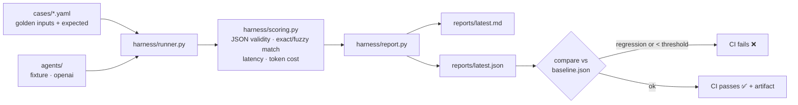

# Agent Eval & Observability Harness


A lightweight Python harness that runs **golden test cases** against LLM agents, scores **accuracy, JSON validity, latency and cost**, compares prompt/model versions against a baseline, and **fails CI on regressions**.

## Problem

LLM agents break quietly. A prompt tweak or model swap can drop extraction accuracy or produce invalid JSON, and nobody notices until production. This harness treats agent behavior like code: every PR gets a scored eval run, and a regression blocks the merge.

## Architecture



**Tasks covered (12 golden cases):**
- `extract_listing`: pull brand / product / condition / price from a marketplace listing
- `margin_calc`: reseller profit and margin from buy / sell / fee %
- `classify_ticket`: route support tickets to billing / shipping / technical / returns / general

**Scoring:** numbers match within a 1% tolerance, strings match exactly or fuzzily (≥0.85 similarity), per-field accuracy plus whole-case exact match. Cost comes from token usage × a per-model price table.

## Run it

```bash
pip install -r requirements.txt
python -m harness.runner --agent fixture --cases cases/          # offline, no API key
pytest -q

# compare against a baseline and gate
python -m harness.runner --agent fixture --baseline reports/baseline.json --min-accuracy 0.8

# real model (optional)
pip install openai && cp .env.example .env   # set OPENAI_API_KEY
python -m harness.runner --agent openai --out reports/openai/
```

The exit code is non-zero if field accuracy falls below `--min-accuracy` or drops more than `--max-regression` vs the baseline. That is what makes CI fail.

## Sample results (fixture agent, real run)

The fixture agent is a deterministic rule-based baseline, so CI runs without network or secrets. It is deliberately imperfect, which means the harness has a real failure to catch.

| Metric | Fixture agent |
|---|---|
| Cases | 12 |
| Exact-match accuracy | 91.7% |
| Field-level accuracy | 97.9% |
| JSON validity | 100.0% |
| Latency p50 / p95 | ~0.01 ms / ~0.03 ms |
| Estimated cost | $0.00 |

| Task | Exact | Field |
|---|---|---|
| extract_listing | 75.0% | 93.8% |
| margin_calc | 100.0% | 100.0% |
| classify_ticket | 100.0% | 100.0% |

The one failure (`extract-003`): the rule-based extractor split on the hyphen in the model number and returned `"WH"` instead of `"WH-1000XM4 headphones"`. That's the kind of gap an LLM agent should close, and the harness measures whether it does. The full per-case report is in [`reports/latest.md`](reports/latest.md).

> OpenAI numbers aren't published here yet. Run `--agent openai` with your key to generate them.

## Adding cases / agents

- **Cases:** drop a YAML or JSON file in `cases/` with `task:` and a list of `{id, input, expected}`.
- **Agents:** add `agents/<name>_agent.py` exposing `MODEL` and `run(task, input) -> {"output", "model", "usage"}`, then pass `--agent <name>`.

## Stack

Python 3.10+, Pydantic v2 (structured outputs), PyYAML, pytest, GitHub Actions, OpenAI SDK (optional).

## License

MIT
